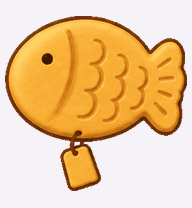

# 爱莉与鱼烧 · Aili & Yushao

两只自定义桌面宠物的透明动画图集，来自作者的 ChatGPT 宠物库。

| 爱莉 | 鱼烧 |
| --- | --- |
|  |  |
| 粉紫色、超大头 Q 版桌面伙伴，以爱莉希雅为灵感。 | 浅棕色鲷鱼烧，无拟人身体和四肢，傲娇但靠谱。 |

## 下载

点击 **Code → Download ZIP**，解压即可获得完整文件。

- [爱莉动画图集](pets/aili/spritesheet.png) · [所有状态预览](previews/aili-states.jpg)
- [鱼烧动画图集](pets/yushao/spritesheet.png) · [所有状态预览](previews/yushao-states.jpg)

## 文件与格式

每只宠物包含 `pet.json` 和 `spritesheet.png`。图集为透明 RGBA PNG，尺寸 **1536 × 2288**，8 列 × 11 行，每格 **192 × 208**，v2 格式。

| 行（从 0 开始） | 状态 | 帧数 |
| --- | --- | ---: |
| 0 | idle：待机 | 6 |
| 1 | running-right：向右移动 | 8 |
| 2 | running-left：向左移动 | 8 |
| 3 | waving：打招呼 | 4 |
| 4 | jumping：跳跃 | 5 |
| 5 | failed：失败反应 | 8 |
| 6 | waiting：等待输入 | 6 |
| 7 | running：工作中 | 6 |
| 8 | review：检查工作 | 6 |
| 9–10 | 16 个观察方向 | 每行 8 |

观察方向从朝上 0° 开始，按屏幕坐标顺时针每隔 22.5° 一帧。每行动画从最左侧开始。两份云端原图在第 0 行第 6 列额外保留了一个静态参考帧；本仓库完整保留导出原图，其他未使用格子透明。要求未使用格子全透明的严格导入器可能需要适配这个额外参考帧。`manifest.json` 提供状态表和原图 SHA-256 校验值。

## 在本地 Codex 安装

适用于支持本地自定义宠物目录的 Codex 版本。此仓库提供素材，不包含宠物运行程序；ChatGPT 云端宠物导入取决于产品支持的导入功能，不能通过复制本地目录完成。

在解压后的仓库目录运行 Windows PowerShell：

```powershell
powershell -NoProfile -File .\scripts\install-pets.ps1
```

安装脚本优先使用 `CODEX_HOME`，否则写入用户目录下的 `.codex/pets`。若同名宠物已存在，脚本会停止以保留原文件。安装后重新打开 Codex，在支持自定义宠物的选择界面选择爱莉或鱼烧。

也可手动将 `pets/aili` 和 `pets/yushao` 两个文件夹复制到 `.codex/pets/`。Mac/Linux 可使用同样的目录结构。

## 许可与来源

本仓库由 [doniko404](https://github.com/doniko404) 发布。原图从作者拥有的两只自定义 ChatGPT 宠物导出，预览直接从图集提取。代码、文档及发布者有权许可的素材采用 [MIT 许可证](LICENSE)。

爱莉以既有角色爱莉希雅为灵感，属于非官方同人作品。角色、名称及其他第三方权利仍归各自权利人；MIT 许可仅覆盖发布者有权授予的权利，不授予第三方角色或商标的权利。详见 [NOTICE.md](NOTICE.md)。
